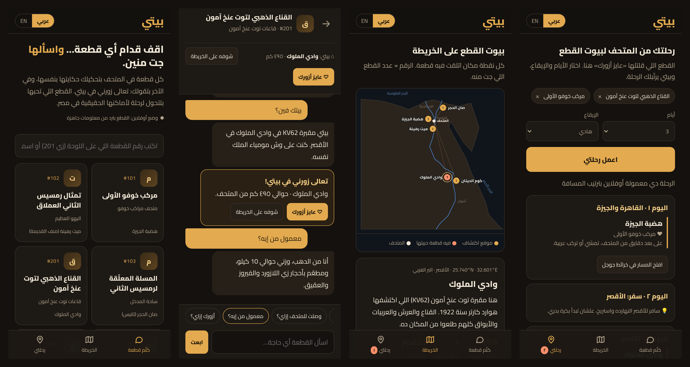

<div dir="rtl">

# بيتي · Beity

**القطعة بتحكيلك حكايتها في المتحف المصري الكبير… وبعدين بتعزمك تزور بيتها.**



مشروع لهاكاثون المتحف المصري الكبير 2026. التطبيق بيكمّل زيارة المتحف برّه المتحف:

1. **كلّم قطعة:** تقف قدام القطعة، تكتب الرقم اللي على اللوحة (أو تمسح QR)، والقطعة ترد عليك بنفسها بالعامية المصرية.
2. **بيتها فين:** كل قطعة بتقولك اتلقت فين في مصر، ولو عجبتك تقولها «عايز أزورك».
3. **رحلتي:** القطع اللي حبيتها بتتحول لرحلة يوم بيوم لأماكنها الحقيقية، وكل يوم معاه مسار في خرائط جوجل.
4. **جواز سفر الأصول:** لما توصل فعلاً لمكان القطعة، بتاخد ختم بالـGPS.

## ليه مختلف عن خرائط جوجل أو ChatGPT؟

- **الربط بين القطعة ومكان اكتشافها** هو قلب المشروع، وده محتاج داتا موثّقة من المتحف نفسه.
- **الرحلة بتبدأ من اللي عجبك جوه المتحف،** مش من مكان لازم تكون عارفه.
- **الـAI مقيّد بالمعلومات الموثّقة بس،** وممنوع يألّف تواريخ أو أرقام. ولو سألته حاجة مش عارفها، بيقولك اسأل فريق المتحف.
- **بيشتغل من غير نت:** لو الـAI مش متاح، القطع بترد من معلومات جاهزة والرحلة بتتعمل بخوارزمية بالمسافة.

## التشغيل

```bash
pip install -r requirements.txt
cp .env.example .env      # حط GEMINI_API_KEY أو ANTHROPIC_API_KEY (اختياري)
python server.py          # http://127.0.0.1:8000
```

للعرض: افتح `/?demo=1`، وده بيظهر زرار «محاكاة الوصول» عشان تاخد الختم من غير ما تسافر.
ولينك قطعة معيّنة (للـQR): `/#mask`.

## النشر على Render

المشروع فيه `render.yaml` جاهز. اعمل **New → Web Service** من الريبو ده، وضيف `GEMINI_API_KEY` في الـEnvironment (اختياري).

## التقنيات

| الجزء | التقنية |
|---|---|
| Backend | Python · FastAPI · Gemini / Claude API |
| Frontend | HTML/CSS/JS من غير frameworks · PWA (بيتثبّت على الموبايل وبيشتغل أوفلاين) |
| الخريطة | SVG مرسومة بالكود من الإحداثيات |

### الـAPI

- `GET /api/health`: هل الـAI متصل؟
- `POST /api/chat` ‏`{piece, messages, language}`: القطعة بترد بصيغة المتكلم.
- `POST /api/plan` ‏`{pieces, days, pace, language}`: خطة رحلة JSON، والسيرفر بيشيل أي موقع مش موجود في الداتا.

## الداتا

نسخة تجريبية فيها 10 قطع من 5 مواقع (الجيزة، منف، تانيس، وادي الملوك، كوم الحيتان) في `data.json`، والمصادر موجودة جنب كل قطعة. المتحف يقدر يوصّل التطبيق بقاعدة بياناته الكاملة.
المسافات بخط مستقيم وتقريبية.

---

صنعه [Mohamed Elsaeed](https://www.linkedin.com/in/mohammed-elsaeed-954a01356) · طالب ذكاء اصطناعي في جامعة الدلتا للعلوم والتكنولوجيا.

</div>

---

**English:** Beity lets Grand Egyptian Museum visitors talk to artifacts in Egyptian Arabic, then turns the pieces they love into a day-by-day trip to the real places they were found, with a GPS stamp passport. FastAPI + Gemini/Claude, vanilla JS PWA, offline fallback. Built for the GEM Hackathon 2026.
